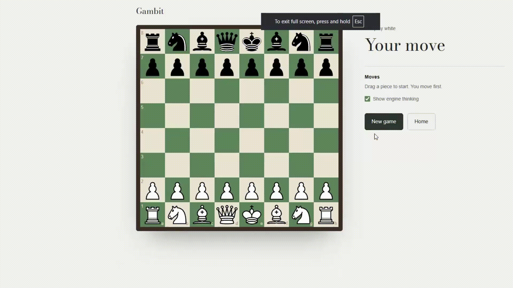
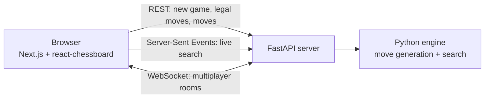

# Gambit

A chess engine written in Python, served by FastAPI and played in the browser through a Next.js front end. You can play against the engine, watch its search live as it thinks, or send a link to a friend and play them in real time.

**Live site:** https://gambit-pi.vercel.app/



> The backend runs on Render's free tier, which sleeps when idle. The first request after a quiet spell can take 30 to 60 seconds while it wakes up.

## Features

- **Play the engine.** Negamax search with alpha-beta pruning, three half-moves deep, about 1 second per move on the live server.
- **Watch it think.** The search streams to the browser while it runs: arrows for the line being examined, red flashes where a branch is pruned, a heatmap of how many positions each candidate move cost, and a live log. It can be switched off.
- **Play a friend.** Create a room, share the link, and play over WebSockets. The server validates every move and enforces turns.
- **Full rules.** Castling, en passant, promotion (to a queen), check, checkmate, stalemate and resignation.

## How it works



The server is the only referee. The browser never decides whether a move is legal: it sends moves like `e2e4`, and the server matches them against the engine's legal-move list, so illegal moves are rejected and special moves (castling, en passant) come out right automatically.

### The search

- **Negamax with alpha-beta pruning.** Every side maximises its own score, and branches that are proven worse than an option already found are skipped.
- **MVV-LVA move ordering.** Captures are searched first, most valuable victim and least valuable attacker first (pawn takes queen before queen takes pawn). Good moves first means earlier cutoffs.
- **Evaluation.** Material plus piece-square tables, so pieces are rewarded for good squares: knights in the centre, advanced pawns, a sheltered king.

### Streaming the search

The engine reports what it is doing through a callback (`emit`), so it knows nothing about the web. The server runs the search in a background thread with `emit` set to a thread-safe queue, and streams each event to the browser as Server-Sent Events:

- `look`: the line being examined right now, sent at most 20 times a second
- `prune`: a branch that was cut, throttled
- `candidate`: a finished top-level move with its score and how many positions it cost
- `done`: the move played and the new board

Snapshots are rate-limited and moves are only converted to text when an event is actually sent, so streaming adds almost nothing to the search time.

## Results

Measured with on three positions (start, an Italian Game opening, and a middlegame), depth 3:

| Search | Nodes searched | Time | vs plain negamax |
|---|---:|---:|---|
| Plain negamax | 85,242 | 3.5s | baseline |
| Alpha-beta | 7,889 | 0.7s | 90.7% fewer nodes |
| Alpha-beta + MVV-LVA | 5,770 | 0.7s | **93.2% fewer nodes, 5.2x faster** |

All three searches return identical evaluations in every position, so the pruning changes the cost, not the answer. As a correctness check, plain negamax from the starting position visits 9,322 nodes, which equals the known perft counts (20 + 400 + 8,902).

**Profiling the live server.** After deploying, moves took around 15 seconds on Render. The cause was move generation at the bottom of the tree: the search generated legal moves for every position one level above the leaves, then threw them away because leaves are only scored. Generating moves only after the depth check brought the live average down to **about 1 second per move** (average of 20 moves), with no change to the moves the engine picks.

## Running it locally

Backend (from the repo root):

```bash
pip install -r requirements.txt
uvicorn server:app --reload
```

The API docs are then at `http://localhost:8000/docs`.

Front end (in a second terminal):

```bash
cd chessproject
npm install
npm run dev
```

Open `http://localhost:3000`.

Environment variables, all optional for local use:

| Variable | Where | Default |
|---|---|---|
| `NEXT_PUBLIC_API_URL` | front end | `http://localhost:8000` |
| `NEXT_PUBLIC_WS_URL` | front end | `ws://localhost:8000` |
| `ALLOWED_ORIGINS` | backend | `http://localhost:3000` |

There is also the original desktop version, `ChessMain.py`, which uses Pygame (`pip install pygame`).

To reproduce the benchmark: `python benchmark.py`.

## API

| Method | Path | Does |
|---|---|---|
| POST | `/new-game` | Creates a game, returns its id and board |
| GET | `/game/{id}/legal-moves` | Legal moves as text, like `e2e4` |
| POST | `/game/{id}/move` | Plays `{"move": "e2e4"}`, or 400 if illegal |
| POST | `/game/{id}/ai-move` | The engine replies |
| POST | `/game/{id}/ai-move-stream` | The engine replies, streaming its search |
| WS | `/ws/{id}` | Multiplayer room for one game |

## Project layout

```
ChessEngine.py   board state, move generation, rules
chessAi.py       search, move ordering, evaluation
server.py        FastAPI: REST, streaming and WebSocket endpoints
benchmark.py     node and time measurements
ChessMain.py     original Pygame desktop version
chessproject/    Next.js front end
```

## Limitations

- Games are stored in memory, so a server restart (a redeploy, or Render waking from sleep) ends open games. The page starts a new one automatically.
- Check detection generates every opponent move, which is the main remaining cost. Looking outward from the king instead would make move generation much faster.
- Pawns always promote to a queen. Threefold repetition and the fifty-move rule are not implemented.

## Credits

- The core move generator and the Pygame version started from [TUTORIAL_NAME](TUTORIAL_LINK). On top of it I added move ordering, piece-square evaluation, the API, the web front end, multiplayer, the live search view and the measurements.
- Piece-square table values are from Tomasz Michniewski's [Simplified Evaluation Function](https://www.chessprogramming.org/Simplified_Evaluation_Function).
- The board is drawn with [react-chessboard](https://github.com/Clariity/react-chessboard).
